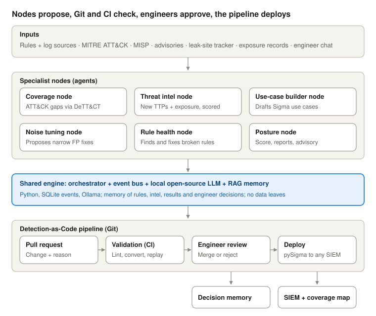
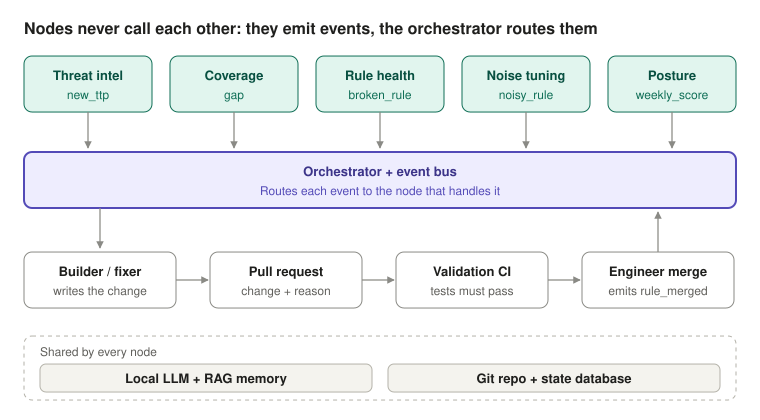

# Leverage your detection

**A multi-agent AI platform that helps detection engineers take their SOC's current detection posture to the next level.**

> **Status: agent wiring prototype.** The eight agents, the orchestrator, the event bus, decision memory, weekly reports and Navigator layers run end to end on placeholder use cases and placeholder intel. Detection logic and attack replay are not part of this prototype yet, so it proves the agents work together, not detection quality.

## Run it

Needs only Python 3.9+ (no packages to install).

```bash
git clone https://github.com/Fattah-S/Leverage-your-detection.git
cd Leverage-your-detection
python3 -m lyd demo            # two simulated weeks; outputs in docs/demo/
python3 -m unittest -v         # 13 end-to-end tests
```

Optional, with a local LLM writing the text ([Ollama](https://ollama.com) installed and running):

```bash
ollama pull llama3.2
python3 -m lyd demo --llm ollama --model llama3.2
```

### What the demo run shows

From [`docs/demo/run-trace.md`](docs/demo/run-trace.md), generated by the run (87 events, 8 agents):

| Story | What happened |
| --- | --- |
| Intel to merged use case | A relevant intel item raised `new_ttp`, coverage found a gap, the builder proposed a use case, validation passed, the engineer merged, coverage re-scored |
| Irrelevant intel | An item for another sector and region was scored low and ignored |
| No data, no rule | A technique with no log source was reported as "needs a log source" instead of a rule |
| Memory | A proposal the engineer rejected in week 1 was not proposed again in week 2 |
| Exposure | Leaked accounts became 90-day watchlist use cases |
| Rule health | A use case mapped to a retired technique was remapped using ATT&CK's own replacement data (T1562.001 → T1685); a use case needing an uncollected log source was paused; a missing owner was assigned |
| Noise tuning | A one-field exclusion was blocked as too broad; the next week, with better evidence, a two-field exclusion was merged |
| Duplicates | A draft that duplicated an existing use case was blocked by validation |

Priority coverage (techniques used by the profile's threat groups, MITRE ATT&CK v20): 6.0% → 8.2% → 9.7% over the two weeks. These numbers come from placeholder data and only show that the loop moves coverage; see [`docs/demo/week-1/report.md`](docs/demo/week-1/report.md) and [`week-2`](docs/demo/week-2/report.md).

## Status of each part

| Part | Prototype |
| --- | --- |
| Orchestrator + SQLite event bus | Built |
| Coverage, threat intel, rule health, noise tuning, builder, validation, posture agents | Built, at metadata level |
| Engineer review | Simulated by a review policy file in the demo |
| Decision memory | Built (simple store; RAG search later) |
| Weekly report + Navigator layer | Built |
| LLM | Mock by default; local Ollama supported |
| Detection logic, Sigma conversion, replay tests | Not built |
| Real pull requests, chatbot, monthly advisory | Not built |

## The problem

Most SOCs don't know which ATT&CK techniques they can actually detect. Writing and testing each new rule takes days, noisy rules drain analyst time, broken rules fail silently, and new threat intel arrives faster than engineers can turn it into detections.

## The idea

A team of specialist AI agents ("nodes") works alongside detection engineers. They measure coverage, watch threat intel, draft and repair use cases, and report on posture. Every change arrives as a pull request with its reason and test results, so engineers stay in control and nothing reaches the SIEM without their approval.



## The seven nodes

| Node | Job | Output to the engineer |
| --- | --- | --- |
| Coverage | Scores ATT&CK coverage with DeTT&CT from tested rules and available log sources; separates "no rule" from "no data" | Gap list, ATT&CK Navigator layers |
| Threat intel | Tracks new TTPs (MITRE ATT&CK, MISP, advisories) and exposure (leak-site trackers, leaked-account records); scores relevance to the organisation's sector, region and stack | "New relevant TTP" or exposure alert + coverage check |
| Use-case builder | Drafts use cases in Sigma with the reason each one is needed | Pull request with a tested draft |
| Noise tuning | Groups a rule's alerts, finds the likely benign pattern, proposes a narrow exclusion; never suppresses on its own | Pull request with alerts before vs after |
| Rule health | Finds broken, silent and outdated rules (syntax, missing fields or log sources, never fires) | Error report + pull request with the fix |
| Validation | Runs in CI on every change: lint, conversion, replay tests | Pass / fail on the pull request |
| Posture | Rolls coverage, health and noise into one maturity score and trend | Weekly report, monthly use-case advisory |

In every node, **code does what must be exact** (counts, scores, tests) and **the LLM does what needs reading, reasoning or writing**. The AI never "proves" its own work: deterministic tests do.

## How the nodes connect



Nodes never call each other. Each node emits events (`new_ttp`, `gap`, `noisy_rule`, `broken_rule`, `rule_merged`) and an orchestrator routes each event to the node that handles it. New nodes can be added without changing the others.

## Detection-as-Code

Git is the single source of truth:

1. Every use case is a file: a Sigma rule plus metadata (ATT&CK mapping, owner, justification, test case, false-positive notes).
2. A node that builds, tunes or fixes a rule opens a pull request with the change and its reason.
3. CI validates it: Sigma lint, conversion to each target SIEM with pySigma, replay tests.
4. The engineer merges, requests changes, or closes with a reason. The reason is stored as feedback.
5. On merge, the pipeline converts and deploys the rule.
6. The coverage and posture nodes re-score from the repo, which closes the loop.

## Outputs

- **Weekly:** posture report with Navigator heatmaps, coverage change, top gaps, new relevant TTPs, rules added, tuned and fixed, noisy and broken rules, and next actions.
- **Monthly:** use-case advisory: top recommended use cases ranked by threat relevance, available data and effort.
- **On demand:** a chatbot ("What's our coverage for credential access?", "Why is this rule noisy?") and pull requests.

## Memory, not retraining

Each week's results and every engineer decision (merged or rejected, with the reason) go into the platform's retrieval (RAG) memory. The model stays the same; what grows is the knowledge it draws on. Drafts get closer to the team's standards and rejected ideas stop coming back. Approval rate, edits per merged PR and false-positive rate of new rules are tracked to prove it.

## Design principles

- **Any SIEM:** rules are written once in Sigma and converted with pySigma.
- **On-prem:** a local open-source LLM (served with Ollama); no data leaves the environment.
- **Engineer in control:** nodes propose, people approve. Threat intel is treated as untrusted input.
- **Proof over claims:** every change carries test results.

## Repository contents

| Path | What it is |
| --- | --- |
| `lyd/` | The prototype: event bus, orchestrator, agents (`lyd/nodes/`), LLM clients, memory, run trace |
| `config/` | Organisation profile (fictional bank) and the review policy that plays the engineer |
| `samples/` | Placeholder use cases (metadata only), intel items and alert statistics |
| `docs/demo/` | Outputs of the last demo run: run trace, weekly reports, Navigator layers |
| `tests/` | End-to-end tests |
| `docs/design.md` | Full design: scope, nodes, flows, use-case template, tech stack, risks, open questions |
| `docs/images/` | Architecture diagrams |
| `data/attack/enterprise-compact.json` | MITRE ATT&CK Enterprise v20.0 techniques, tactics and threat-group technique usage, reduced to what the platform needs |
| `scripts/build_attack_data.py` | Rebuilds that file from MITRE's `enterprise-attack.json` |

## Attribution

MITRE ATT&CK® is a registered trademark of The MITRE Corporation. ATT&CK data is from [mitre/cti](https://github.com/mitre/cti) and used under the [ATT&CK Terms of Use](https://attack.mitre.org/resources/legal-and-branding/terms-of-use/). DeTT&CT, ATT&CK Navigator, Sigma, pySigma, MISP and Ollama are independent open-source projects.

## Author

Mohamed Abdelfattah ([Fattah-S](https://github.com/Fattah-S))
