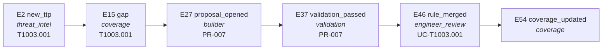
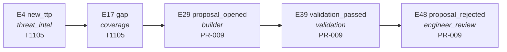
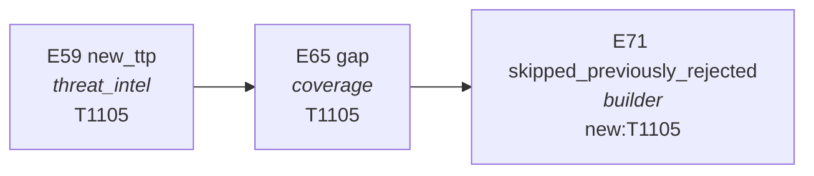
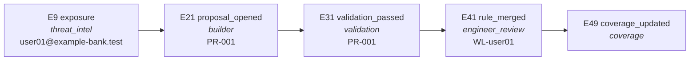
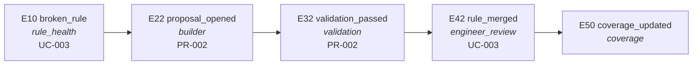
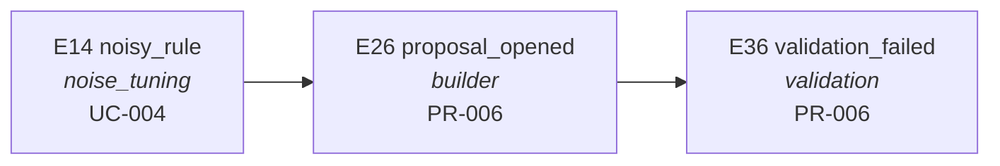
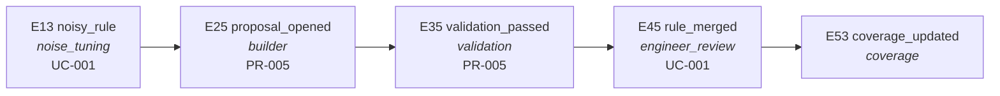

# Run trace

Generated by `python3 -m lyd demo` · 87 events · 8 agents · ATT&CK v20.0 · LLM: mock

> Placeholder use cases and placeholder intel. This proves the agents are linked and the event flow works end to end; it does not measure detection quality.

## Routing table (which agent listens to which event)

| Event | Handled by |
| --- | --- |
| `broken_rule` | builder |
| `exposure` | builder |
| `gap` | builder |
| `new_ttp` | coverage |
| `noisy_rule` | builder |
| `proposal_opened` | validation |
| `report_requested` | posture |
| `rule_merged` | coverage |
| `tick` | threat_intel, rule_health, noise_tuning |
| `validation_passed` | engineer_review |

## Chains from this run

Each box is a real event from the run: its number, type, the agent that emitted it and its subject. Arrows go from an event to the events it caused.

### Threat intel → coverage gap → builder → validation → engineer merge → coverage re-scored

### Gap proposed, engineer rejects it (reason stored in memory)

### Week 2: the same gap is not proposed again (memory)

### Exposure intel → watchlist use case

### Rule health → fix proposal → merged

### Noise tuning → exclusion too broad → validation blocks it

### Noise tuning → narrow exclusion → merged

## Full event log

| # | Event | Emitted by | Caused by | Handled by | Subject |
| --- | --- | --- | --- | --- | --- |
| 1 | `tick` | scheduler |  | threat_intel, rule_health, noise_tuning | week-1 |
| 2 | `new_ttp` | threat_intel | 1 | coverage | T1003.001 |
| 3 | `new_ttp` | threat_intel | 1 | coverage | T1071.001 |
| 4 | `new_ttp` | threat_intel | 1 | coverage | T1105 |
| 5 | `new_ttp` | threat_intel | 1 | coverage | T1059.001 |
| 6 | `new_ttp` | threat_intel | 1 | coverage | T1505.003 |
| 7 | `new_ttp` | threat_intel | 1 | coverage | T1547.001 |
| 8 | `intel_ignored` | threat_intel | 1 | - | intel-002 |
| 9 | `exposure` | threat_intel | 1 | builder | user01@example-bank.test |
| 10 | `broken_rule` | rule_health | 1 | builder | UC-003 |
| 11 | `broken_rule` | rule_health | 1 | builder | UC-005 |
| 12 | `broken_rule` | rule_health | 1 | builder | UC-006 |
| 13 | `noisy_rule` | noise_tuning | 1 | builder | UC-001 |
| 14 | `noisy_rule` | noise_tuning | 1 | builder | UC-004 |
| 15 | `gap` | coverage | 2 | builder | T1003.001 |
| 16 | `gap` | coverage | 3 | builder | T1071.001 |
| 17 | `gap` | coverage | 4 | builder | T1105 |
| 18 | `covered` | coverage | 5 | - | T1059.001 |
| 19 | `needs_log_source` | coverage | 6 | - | T1505.003 |
| 20 | `gap` | coverage | 7 | builder | T1547.001 |
| 21 | `proposal_opened` | builder | 9 | validation | PR-001 |
| 22 | `proposal_opened` | builder | 10 | validation | PR-002 |
| 23 | `proposal_opened` | builder | 11 | validation | PR-003 |
| 24 | `proposal_opened` | builder | 12 | validation | PR-004 |
| 25 | `proposal_opened` | builder | 13 | validation | PR-005 |
| 26 | `proposal_opened` | builder | 14 | validation | PR-006 |
| 27 | `proposal_opened` | builder | 15 | validation | PR-007 |
| 28 | `proposal_opened` | builder | 16 | validation | PR-008 |
| 29 | `proposal_opened` | builder | 17 | validation | PR-009 |
| 30 | `proposal_opened` | builder | 20 | validation | PR-010 |
| 31 | `validation_passed` | validation | 21 | engineer_review | PR-001 |
| 32 | `validation_passed` | validation | 22 | engineer_review | PR-002 |
| 33 | `validation_passed` | validation | 23 | engineer_review | PR-003 |
| 34 | `validation_passed` | validation | 24 | engineer_review | PR-004 |
| 35 | `validation_passed` | validation | 25 | engineer_review | PR-005 |
| 36 | `validation_failed` | validation | 26 | - | PR-006 |
| 37 | `validation_passed` | validation | 27 | engineer_review | PR-007 |
| 38 | `validation_passed` | validation | 28 | engineer_review | PR-008 |
| 39 | `validation_passed` | validation | 29 | engineer_review | PR-009 |
| 40 | `validation_failed` | validation | 30 | - | PR-010 |
| 41 | `rule_merged` | engineer_review | 31 | coverage | WL-user01 |
| 42 | `rule_merged` | engineer_review | 32 | coverage | UC-003 |
| 43 | `rule_merged` | engineer_review | 33 | coverage | UC-005 |
| 44 | `rule_merged` | engineer_review | 34 | coverage | UC-006 |
| 45 | `rule_merged` | engineer_review | 35 | coverage | UC-001 |
| 46 | `rule_merged` | engineer_review | 37 | coverage | UC-T1003.001 |
| 47 | `rule_merged` | engineer_review | 38 | coverage | UC-T1071.001 |
| 48 | `proposal_rejected` | engineer_review | 39 | - | PR-009 |
| 49 | `coverage_updated` | coverage | 41 | - |  |
| 50 | `coverage_updated` | coverage | 42 | - |  |
| 51 | `coverage_updated` | coverage | 43 | - |  |
| 52 | `coverage_updated` | coverage | 44 | - |  |
| 53 | `coverage_updated` | coverage | 45 | - |  |
| 54 | `coverage_updated` | coverage | 46 | - |  |
| 55 | `coverage_updated` | coverage | 47 | - |  |
| 56 | `report_requested` | scheduler |  | posture | week-1 |
| 57 | `report_written` | posture | 56 | - | week-1 |
| 58 | `tick` | scheduler |  | threat_intel, rule_health, noise_tuning | week-2 |
| 59 | `new_ttp` | threat_intel | 58 | coverage | T1105 |
| 60 | `new_ttp` | threat_intel | 58 | coverage | T1204.002 |
| 61 | `new_ttp` | threat_intel | 58 | coverage | T1059.005 |
| 62 | `new_ttp` | threat_intel | 58 | coverage | T1003.001 |
| 63 | `exposure` | threat_intel | 58 | builder | user02@example-bank.test |
| 64 | `noisy_rule` | noise_tuning | 58 | builder | UC-004 |
| 65 | `gap` | coverage | 59 | builder | T1105 |
| 66 | `gap` | coverage | 60 | builder | T1204.002 |
| 67 | `gap` | coverage | 61 | builder | T1059.005 |
| 68 | `covered` | coverage | 62 | - | T1003.001 |
| 69 | `proposal_opened` | builder | 63 | validation | PR-011 |
| 70 | `proposal_opened` | builder | 64 | validation | PR-012 |
| 71 | `skipped_previously_rejected` | builder | 65 | - | new:T1105 |
| 72 | `proposal_opened` | builder | 66 | validation | PR-013 |
| 73 | `proposal_opened` | builder | 67 | validation | PR-014 |
| 74 | `validation_passed` | validation | 69 | engineer_review | PR-011 |
| 75 | `validation_passed` | validation | 70 | engineer_review | PR-012 |
| 76 | `validation_passed` | validation | 72 | engineer_review | PR-013 |
| 77 | `validation_passed` | validation | 73 | engineer_review | PR-014 |
| 78 | `rule_merged` | engineer_review | 74 | coverage | WL-user02 |
| 79 | `rule_merged` | engineer_review | 75 | coverage | UC-004 |
| 80 | `rule_merged` | engineer_review | 76 | coverage | UC-T1204.002 |
| 81 | `rule_merged` | engineer_review | 77 | coverage | UC-T1059.005 |
| 82 | `coverage_updated` | coverage | 78 | - |  |
| 83 | `coverage_updated` | coverage | 79 | - |  |
| 84 | `coverage_updated` | coverage | 80 | - |  |
| 85 | `coverage_updated` | coverage | 81 | - |  |
| 86 | `report_requested` | scheduler |  | posture | week-2 |
| 87 | `report_written` | posture | 86 | - | week-2 |
